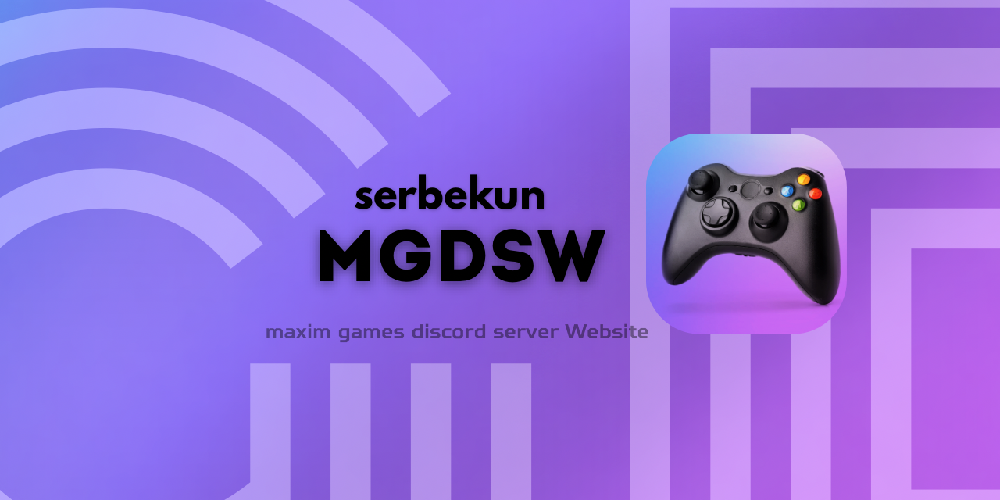

# mgdsw

<div align="center">
  
</div>

Maxim Games Discord Server Web Site. This will be a server for deploying a web server dedicated to the Discord server created by Maxim.

## What problems does this server solve?

**Task one: create a hub for conveniently distributing content created by members of the Discord server.** One place containing the current version of a map or build, along with a description, game version, and installation instructions. No need to search for a month-old link or resend the file again.

**Task two: take recurring work off the server members.** If a person no longer has to explain installation via screen sharing or look for a link in the chat history, the site is working.

## Command that usefully during developing

For build final fat JAR use
```bash
./gradlew shadowjar
```

For run tests use
```bash
./gradlew test
```

## Requirements for start

- JDK 25

The build fat JAR is created under `build/libs/`.

So for run server using fat jar use command. 
```bash
java -jar build/libs/mgdsw-pre-alpha-2026-10-19-all.jar
```