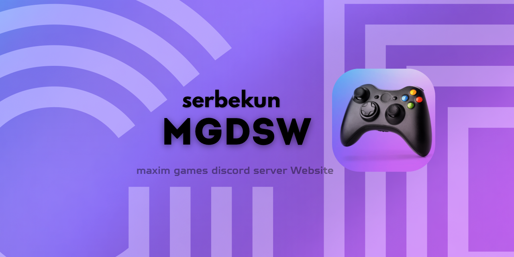

# mgdsw

<div align="center">
  
</div>

Maxim Games Discord Server Web Site. This will be a server for deploying a web server dedicated to the Discord server created by Maxim.

## What problems does this server solve?

**Task one: create a hub for conveniently distributing content created by members of the Discord server.** One place containing the current version of a map or build, along with a description, game version, and installation instructions. No need to search for a month-old link or resend the file again.

**Task two: take recurring work off the server members.** If a person no longer has to explain installation via screen sharing or look for a link in the chat history, the site is working.

## Command that usefully during developing

For build final fat server use
```bash
cargo b
```

For run tests use
```bash
cargo test
```

To clean the runtime `data/` directory use
```bash
./cleanup.sh
```

The server recreates `data/` on the next start and unpacks the packaged templates again. `data/content/` and `data/shared/` hold operator-owned files, so use `--keep-content` to preserve them:

```bash
./cleanup.sh --keep-content   # keep data/content/ and data/shared/
./cleanup.sh --force          # no confirmation prompt
```

## Requirements for start

- installed latest rust version

The server build is created under `target/debug/`.

So for run server  use command. 
```bash
./target/debug/mgdsw
```